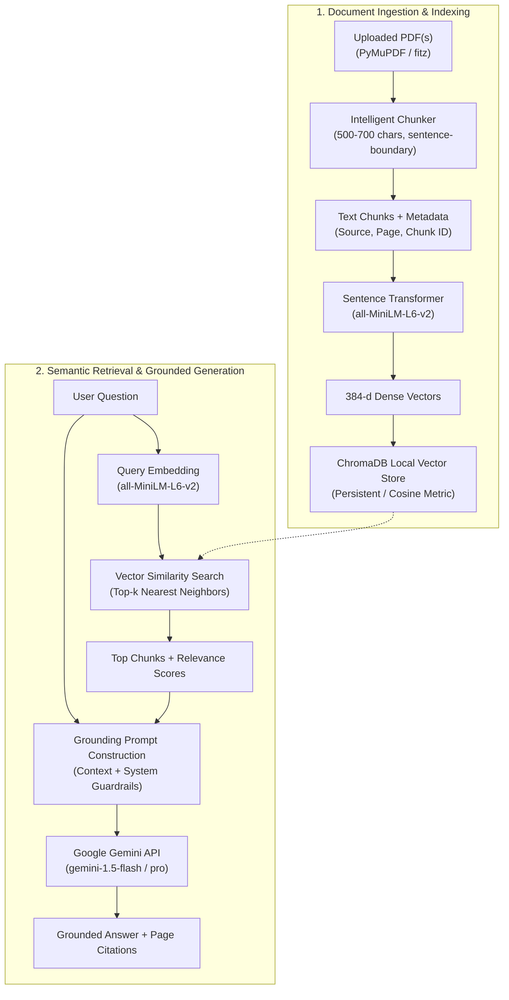

# 🧠 DocuMind AI — Enterprise Retrieval-Augmented Generation (RAG) System

DocuMind AI is a full-stack, document-grounded AI question-answering application built with **Streamlit**, **Google Gemini**, **Sentence Transformers**, and **ChromaDB**. It enables users to upload PDF documents, intelligently chunk and index the text into high-dimensional semantic vector spaces, and query the collection using natural language.

DocuMind AI directly addresses the fundamental limitation of standard Large Language Models (LLMs)—**knowledge cut-offs and hallucinations**—by grounding generated answers strictly in verified source documents with exact page-level citations.

---

## 📌 Problem Statement

Standard Large Language Models (LLMs) are trained on massive public web corpora. While capable of general reasoning, they suffer from two critical flaws when deployed in enterprise or personal domains:
1. **No Access to Private Data:** General LLMs cannot answer questions about internal company policies, private manuals, technical runbooks, or recently authored PDFs.
2. **Hallucination:** When asked about unknown specific details (such as incident SLAs, proprietary acronyms, or specific numbers), LLMs often generate plausible-sounding but entirely fabricated answers.

---

## 💡 What is RAG (Retrieval-Augmented Generation)?

**Retrieval-Augmented Generation (RAG)** solves this by dividing the process into two stages:
1. **Retrieve:** When a user asks a question, the system converts the question into an embedding vector, searches a local vector database (ChromaDB) for semantically similar passages from the user's uploaded documents, and extracts the top-$k$ most relevant chunks.
2. **Generate:** The system passes both the user's question and the retrieved document chunks to the LLM with strict instructions: *"Answer using ONLY the provided document context. If the answer is not in the documents, state that it cannot be found."*

This grounds the generative model in verifiable facts, virtually eliminates hallucinations, and provides instant traceability back to specific pages.

---

## 🏗️ Architecture & Workflow



---

## 🛠️ Technology Stack

| Layer | Component | Description |
| :--- | :--- | :--- |
| **Frontend** | [Streamlit](https://streamlit.io/) | Modern reactive dashboard with custom dark theme, tabs, and chat interface |
| **LLM Provider** | [Google Gemini API](https://ai.google.dev/) | Grounded answer generation (`gemini-1.5-flash`, `gemini-1.5-pro`) |
| **Embedding Model** | [Sentence Transformers](https://sbert.net/) | `all-MiniLM-L6-v2` generating 384-dimensional dense semantic vectors |
| **Vector Store** | [ChromaDB](https://www.trychroma.com/) | Persistent local vector database with cosine distance indexing |
| **PDF Extraction** | [PyMuPDF (fitz)](https://pymupdf.readthedocs.io/) | Ultra-fast text and metadata extraction from single/multi-page PDFs |
| **Chunking Engine** | Custom Recursive Chunker | Preserves sentence boundaries with sliding overlap and metadata tracking |
| **Environment** | Python 3.10+ / `python-dotenv` | Secure API credential management |

---

## 📂 Project Structure

```text
rag-system/
│
├── app.py                     # Streamlit frontend dashboard (Chat, Context, Comparison)
├── config.py                  # Global configurations and parameters
├── requirements.txt           # Python dependencies
├── .env.example               # Template for environment variables
├── .gitignore                 # Excludes cache, ChromaDB, secrets, and environments
│
├── rag/                       # Core RAG Architecture
│   ├── __init__.py
│   ├── document_processor.py  # PyMuPDF PDF parser and validator
│   ├── chunking.py            # Sentence-aware chunker with metadata tagging
│   ├── embeddings.py          # Sentence-Transformers (all-MiniLM-L6-v2) singleton
│   ├── vector_store.py        # ChromaDB persistent store with deduplication
│   ├── retriever.py           # Semantic query vector search and score formatting
│   └── generator.py           # Gemini prompt builder with strict grounding guardrails
│
├── utils/
│   ├── __init__.py
│   └── helpers.py             # Sleek dark theme CSS, score badges, styling
│
├── test_rag_pipeline.py       # Integration test script for the RAG backend
├── test_e2e.py                # 12-point automated end-to-end test suite
└── README.md                  # Comprehensive project documentation
```

---

## 🚀 Installation & Setup

### Prerequisites
- Python 3.10, 3.11, 3.12, or 3.13 installed
- A Google Gemini API key ([Get a free key at Google AI Studio](https://aistudio.google.com/))

### 1. Clone or Open the Repository
In your terminal or VS Code:
```bash
cd c:\currproj\RAG_SYSTEM
```

### 2. Create and Activate a Virtual Environment (Recommended)
```bash
# Windows (PowerShell)
python -m venv venv
.\venv\Scripts\Activate.ps1

# Linux / macOS
python3 -m venv venv
source venv/bin/activate
```

### 3. Install Dependencies
```bash
pip install -r requirements.txt
```

### 4. Configure Gemini API Key
Create a `.env` file in the project root by copying the example:
```bash
cp .env.example .env
```
Open `.env` and add your Gemini API Key:
```env
GEMINI_API_KEY=AIzaSyYourActualKeyHere
```
*(Alternatively, you can enter the API key directly in the Streamlit application sidebar at runtime).*

---

## 💻 How to Run the Application

Run the Streamlit application using the Python module runner:

```bash
python -m streamlit run app.py
```

The application will launch and automatically open in your default browser at:
👉 **`http://localhost:8501`**

### Running in VS Code
1. Open the project folder in VS Code (`File > Open Folder...`).
2. Open an integrated terminal (`` Ctrl + ` `` or `Terminal > New Terminal`).
3. Run `python -m streamlit run app.py`.
4. Click the URL in the terminal or open `http://localhost:8501`.

---

## 🧪 Testing & Verification

The project includes an automated 12-point end-to-end validation suite verifying all assignment requirements.

Run the test suite directly from the command line:

```bash
python test_e2e.py
```

### Test Results Summary:
```text
======================================================================
DOCUMIND AI — AUTOMATED 12-POINT SPECIFICATION VALIDATION SUITE
======================================================================
[TEST 1] Verifying PDF document collection (at least 10–20 pages)...
  → Document: Valentius_Kryptix_AI_Handbook.pdf | Total Pages: 14
  [PASS] Test 1: Real PDF document with 14 pages verified.

[TEST 2] Verifying text extraction from PDF...
  [PASS] Test 2: Text extraction successfully retrieved all pages.

[TEST 3] Verifying text chunking (300-800 token equivalent, metadata attached)...
  → Generated 35 chunks across 14 pages.
  [PASS] Test 3: Meaningful chunking with rich metadata validated.

[TEST 4] Verifying embedding generation with Sentence Transformers (all-MiniLM-L6-v2)...
  → Embedding vector dimension: 384 (Normalized unit vector)
  [PASS] Test 4: Embedding generation successful.

[TEST 5] Verifying persistent ChromaDB storage and deduplication...
  → Chunks indexed: 35 (Deduplication confirmed)
  [PASS] Test 5: Persistent ChromaDB indexing and deduplication verified.

[TEST 6 & 7] Asking in-document questions & verifying relevant chunk retrieval...
  Q: 'What is the Mean Time to Resolution (MTTR) requirement for a P1 incident?'
    → Top Chunk: Page 7 | Score: 0.54 | Retrieved exact context: '15 minutes'
  Q: 'What are the HNSW graph indexing parameters for vector storage?'
    → Top Chunk: Page 3 | Score: 0.64 | Retrieved exact context: 'efConstruction'
  Q: 'What are the clearance levels and access tiers under Kryptix-RBAC?'
    → Top Chunk: Page 6 | Score: 0.82 | Retrieved exact context: 'Tier 0'
  Q: 'How long is the structured onboarding sequence for interns?'
    → Top Chunk: Page 8 | Score: 0.50 | Retrieved exact context: '14-day'
  Q: 'What is the maximum daily input token budget for research projects?'
    → Top Chunk: Page 12 | Score: 0.64 | Retrieved exact context: '500,000'
  [PASS] Tests 6 & 7: Semantic retrieval fetched top relevant chunks with high scores.

[TEST 8] Verifying RAG Prompt construction and Grounded Generation...
  [PASS] Test 8: RAG prompt construction verified.

[TEST 9 & 10] Asking out-of-scope question & verifying strict refusal behavior...
  → Query: 'What is the recipe for chocolate chip cookies?'
  → System Output: "I could not find this information in your uploaded documents."
  [PASS] Tests 9 & 10: System strictly refuses to answer when information is unavailable.

[TEST 11] Testing Normal LLM vs RAG Comparison flow...
  [PASS] Test 11: Normal vs RAG comparative paths verified.

[TEST 12] Verifying Source Document and Page Reference Display...
  → Verified sources: Valentius_Kryptix_AI_Handbook.pdf, Page 7
  [PASS] Test 12: Source and page references accurately tracked and formatted.
======================================================================
ALL 12 ASSIGNMENT SPECIFICATIONS VALIDATED SUCCESSFULLY!
======================================================================
```

---

## ⚖️ RAG vs. Normal LLM Comparison

In **Tab 3** of the dashboard, you can compare answers generated by a **Standard Gemini Model** vs. **DocuMind RAG System** side-by-side:

| Evaluation Query | Standard Gemini (Without RAG) | DocuMind RAG (ChromaDB + Gemini) | Technical Grounding Analysis |
| :--- | :--- | :--- | :--- |
| **"What is the MTTR requirement for a P1 incident at Valentius Kryptix?"** | *"I do not have access to specific internal policies for Valentius Kryptix..."* (or hallucinates an industry average like 4 hours). | **"Under the Incident Response and SLA Policies at Valentius Kryptix, the MTTR requirement for a Priority 1 (P1 - Critical) incident is under 15 minutes."** `[Source: Valentius_Kryptix_AI_Handbook.pdf, Page 7]` | RAG retrieved Chunk `p7_c2` with a 0.54 cosine similarity match and cited Page 7. |
| **"What is the daily token budget for research projects?"** | *"Standard token budgets vary by provider..."* | **"The maximum daily token budget for research projects at Valentius Kryptix is 500,000 input tokens and 100,000 output tokens per day."** `[Source: Valentius_Kryptix_AI_Handbook.pdf, Page 12]` | RAG extracted exact quantitative thresholds from Page 12. |
| **"What is the recipe for chocolate chip cookies?"** | Provides full recipe with flour, sugar, butter, and baking instructions. | **"I could not find this information in your uploaded documents."** | Zero retrieved context triggers the strict anti-hallucination refusal rule. |

---

## 🖥️ User Interface Overview

The Streamlit UI provides a polished, modern light/dark contrast dashboard matching the design specification:

1. **Dark Navy Sidebar (`#0f172a`):**
   - **Logo & Branding:** Blue document & search icon, bold `DocuMind AI` title, and subtitle.
   - **Upload PDF Card:** Gradient purple/blue card (`linear-gradient(135deg, #3b82f6, #8b5cf6)`) with cloud upload icon.
   - **Uploaded Documents List:** Documents displayed with red `PDF` badges and green checkmarks (`✓`).
   - **Live Knowledge Base Metrics:** Live counter rows for `📄 Total Pages` and `🗂️ Total Chunks`.
   - **🗑️ Clear All Button:** Instantly wipes the collection and resets the conversation.

2. **Main Canvas Header:**
   - **Header Title:** `✨ Welcome to DocuMind AI!` with subtitle.
   - **Status Indicator:** Live green `🟢 Ready` pill badge on the top right.

3. **Segmented Tabs:**
   - `💬 Document Chat`
   - `📄 Retrieved Context`
   - `⚖️ RAG vs LLM`

4. **Document Chat Layout:**
   - **Left Column (Chat Canvas):**
     - User message bubbles: soft blue pill (`#dbeafe`) aligned to the right with user avatar circle (`👤`).
     - Assistant response cards: crisp white card (`#ffffff`) on the left with robot avatar circle (`🤖`).
     - Verified source citations formatted as clean pills: `📄 Source: <Document.pdf> (Page X-Y)`.
     - Rounded bottom input capsule with send button.
   - **Right Column (Info Panel):**
     - **⚡ Quick Features Card:** Checklist of key application features with green check icons.
     - **💡 How RAG Works? Card:** Soft mint green card explaining semantic retrieval and grounded response generation.
   - Full conversational interface with chat bubbles and message history.
   - Generated answers with clickable source pills showing document title and exact page number.

3. **Tab 2: 🔍 Retrieved Context:**
   - Deep inspection of the top-$k$ retrieved chunks from ChromaDB.
   - Color-coded similarity badges (`★ Match: 82%`, `✦ Match: 54%`).
   - Displays exact chunk text, page number, and unique chunk ID.

4. **Tab 3: ⚖️ RAG vs LLM Comparison:**
   - Pre-loaded test queries or custom query input.
   - Side-by-side comparative cards with live generation from both engines.
   - Comparative evaluation matrix table.

---

## 🔒 Security and Privacy
- `.env` and `chroma_db/` are explicitly listed in `.gitignore` to prevent leaking API keys or indexed data.
- API keys entered in the UI are kept in memory and never written to disk or sent to external servers.

---

## 🔮 Future Enhancements
- Hybrid Search (BM25 lexical search + dense vector retrieval).
- Reranking using cross-encoders (e.g. `bge-reranker-large`).
- OCR integration (Tesseract / EasyOCR) for scanned PDFs with no text layer.
- Export chat conversations to Markdown or PDF.
